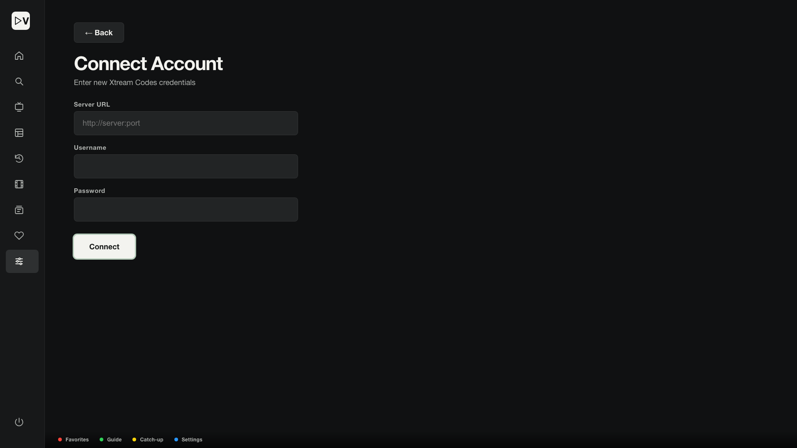

<div align="center">


# Vela Stream (Samsung Tizen OS)

**A clean, fast, open-source Xtream Codes IPTV player built for Samsung Tizen Smart TVs.**

[](https://developer.samsung.com/smarttv)
[](https://developer.samsung.com/smarttv/develop/api-references/samsung-product-api-references/avplay-api.html)
[](LICENSE)

*No IPTV servers, accounts, or API keys are bundled — bring your own Xtream Codes credentials.*

<br/>



</div>

---

## Highlights

- **Built for TV Hardware** — pure vanilla HTML/CSS/JS tuned for Samsung Tizen 5.0+ (1920×1080) with spatial remote navigation and zero framework overhead
- **Hardware Playback** — uses Samsung's native `AVPlay` (`application/avplayer`) for smooth Live TV, Movies, Series, and Catch-up streams
- **Continue Watching** — remembers your exact playback position per movie/episode and automatically advances to the next episode when finished
- **Timeline Preview Seeking** — press **Up** from player controls to focus the timeline, **Left/Right** to preview with hold acceleration, **OK** to seek, **Back** to cancel
- **EPG & Reminders** — browse Live TV program guides and get on-screen reminders before shows start
- **Optional Online Subtitles** — bring your own OpenSubtitles.com API key in **Settings → Subtitles** with live `±0.5s` timing sync

---

## Remote Control Shortcuts

| Key | Action |
| :--- | :--- |
| **D-Pad / OK** | Navigate categories, channels, and player controls |
| **Up** *(in player)* | Focus timeline scrubber for preview seeking |
| **Red / Green / Yellow / Blue** | Quick jump to Favorites · Guide · Catch-up · Settings |
| **Back** | Return / cancel timeline seek without leaving playback |

---

## Build & Install on Samsung TV

1. Clone this repository:
   ```bash
   git clone https://github.com/elmahdibihi/vela-stream-tizen.git
   ```
2. Open the folder in **Tizen Studio** (with TV Extensions 5.0+ installed).
3. Create or select your own Samsung author & distributor certificate in **Certificate Manager**.
4. Right-click the project → **Build Signed Package** to generate a `.wgt`, then deploy to your TV via **Device Manager** or `tizen install`.
5. Launch **Vela Stream** on your TV and enter your own **Server URL**, **Username**, and **Password**.

---

## License

MIT — see [LICENSE](LICENSE).
